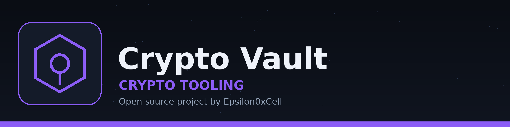

# crypto-vault

A small command line tool that encrypts a single password string and saves the encrypted token to a file, and later decrypts a saved token back to the original password. Encryption uses the Fernet symmetric encryption provided by the Python cryptography library, with a key stored in a local key file.

It is not a vault with accounts or entries: it stores one password per file, and it encrypts password strings, not whole files.

## Requirements

- Python 3.10 or later (tested on Python 3.12)
- cryptography 41.0 or later, listed in requirements.txt

The other modules it uses (argparse, logging, os, sys) are part of the Python standard library and do not need to be installed.

## Installation

1. Clone the repository: `git clone https://github.com/ShadowGuardAI/crypto-vault.git`
2. Move into the directory: `cd crypto-vault`
3. Install the dependency: `pip install -r requirements.txt`

There is no PyPI package and no `crypto-vault` command. The tool is run as `python main.py ...` from the cloned directory.

## How the key works

On first use the tool creates a key file named `crypto_vault.key` in the current working directory and reuses it on later runs from the same directory. Keep this file safe and backed up: a saved password cannot be decrypted without the exact key that encrypted it, and tokens decrypted from a different working directory (with a different key) will fail.

## Usage

```
python main.py [-h] {encrypt,decrypt} ...
```

### Encrypt a password

```
python main.py encrypt PASSWORD FILENAME
```

- `PASSWORD`: the password string to encrypt
- `FILENAME`: the file to save the encrypted token to

Example:

```
python main.py encrypt "S3cret!Pass" mypassword.enc
```

This prints `Password encrypted and saved successfully.`

### Decrypt a saved password

```
python main.py decrypt FILENAME
```

Example:

```
python main.py decrypt mypassword.enc
```

This prints `Decrypted password: S3cret!Pass`

## Limitations

- Only the two subcommands above exist. There is no list, delete, or search command, and no interactive interface.
- The first argument to `encrypt` is the password itself, not a file to encrypt. Passing a filename encrypts the filename string, not the contents of that file.
- Anyone with both the token file and `crypto_vault.key` can decrypt the password. Protect the key file like the passwords themselves, and do not commit it to version control.
- Decrypting a missing file or a file that is not a valid token for the current key fails with an error message and exit code 1.
- Do not rely on this simple tool for highly sensitive secrets; the security of the result depends on protecting the key file.

## License

crypto-vault is licensed under the GNU General Public License v3.0 (GPL-3.0). See LICENSE.
