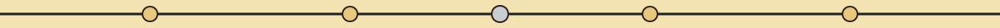
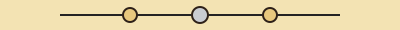

# crypto-single-password-encryptor

Title block: a sanctuary notice nailed to the pile. The name above is set in Bodoni Moda in darkened silver upon lamplight pale, ruled beneath, with a small log end disc drawn once at the left of this first heading only. The remaining headings keep the notice form as lettering alone.




# crypto-single-password-encryptor

A small command line tool that encrypts a single password string and saves the encrypted token to a file, and later decrypts a saved token back to the original password. Encryption uses the Fernet symmetric encryption provided by the Python cryptography library, with a key stored in a local key file.

It is not a vault with accounts or entries: it stores one password per file, and it encrypts password strings, not whole files.



## Requirements

- Python 3.10 or later (tested on Python 3.12)
- cryptography 41.0 or later, listed in requirements.txt

The other modules it uses (argparse, logging, os, sys) are part of the Python standard library and do not need to be installed.


## Installation

1. Clone the repository: `git clone https://github.com/ShadowGuardAI/crypto-single-password-encryptor.git`
2. Move into the directory: `cd crypto-single-password-encryptor`
3. Install the dependency: `pip install -r requirements.txt`

There is no PyPI package and no `crypto-single-password-encryptor` command. The tool is run as `python main.py ...` from the cloned directory.

> Bark plate caution, dusk mauve at the edge: the first install step above is flagged in place. Its clone line names the organisation in an unhyphenated form, where the hyphenated organisation name belongs. The line stands as printed and is not silently mended.


## How the key works

On first use the tool creates a key file named `crypto_vault.key` in the current working directory and reuses it on later runs from the same directory. The file is created with owner only permissions (0600). When an existing key file is loaded with group or other permissions set, the tool tightens it to 0600 and prints a warning; if tightening fails, it warns that the key is readable by others and should be restricted by hand. Keep this file safe and backed up: a saved password cannot be decrypted without the exact key that encrypted it, and tokens decrypted from a different working directory (with a different key) will fail.

> Bark plate caution, dusk mauve at the edge: anyone holding token and key alike can read the saved wording. The token is only as safe as the key file beside it, and the keeping this tool offers is keeping by leaving alone, not locking.


## Usage

```
python main.py [-h] {encrypt,decrypt} ...
```

### Encrypt a password

```
python main.py encrypt PASSWORD FILENAME
```

- `PASSWORD`: the password string to encrypt
- `FILENAME`: the file to save the encrypted token to

Example:

```
python main.py encrypt "REDACTED" mypassword.enc
```

This prints `Password encrypted and saved successfully.`

### Decrypt a saved password

```
python main.py decrypt FILENAME
```

Example:

```
python main.py decrypt mypassword.enc
```

This prints `Decrypted password: REDACTED`

> Bark plate caution, dusk mauve at the edge: Saving a token to a filename that already holds one replaces the earlier token without warning. The file is written outright and the file is the whole record.


## Limitations

- Only the two subcommands above exist. There is no list, delete, or search command, and no interactive interface.
- The first argument to `encrypt` is the password itself, not a file to encrypt. Passing a filename encrypts the filename string, not the contents of that file.
- Anyone with both the token file and `crypto_vault.key` can decrypt the password. Protect the key file like the passwords themselves, and do not commit it to version control.
- Decrypting a missing file or a file that is not a valid token for the current key fails with an error message and exit code 1.
- Do not rely on this simple tool for highly sensitive secrets; the security of the result depends on protecting the key file.


## License

crypto-single-password-encryptor is licensed under the GNU General Public License v3.0 (GPL-3.0). See LICENSE.


Keeper's notes, entered plainly at the close. A decrypt run loads its token before it touches the key, so decrypting a missing file in a fresh directory fails without creating a key file as a side effect, whereas an encrypt run in that same directory does create one. A successful encrypt or decrypt ends at exit 0, and an encrypt failure exits 1. Redaction override: the live README prints one concrete example password value twice, once in the encrypt example and once as the shown output of the decrypt example. Both occurrences are preserved in redacted form in this edition, the value is never reproduced, and the exclusion is recorded in the content proof. The story closes on the pile at dusk, the lamp withdrawn, the beetle gone into the wood, and the one saved thing resting in the dark where it was left, neither listed nor visited.
